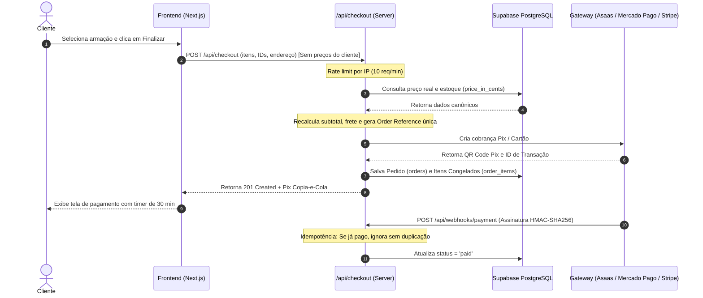

# Arquitetura de Checkout Seguro e Integração de Gateway — Ótica Ventara

## 1. Visão Geral da Estratégia de Pagamento

A **Ótica Ventara** opera em modelo de e-commerce híbrido premium:
1. **Checkout Online Direto**: Compra de armações e óculos solares com pagamento instantâneo via Pix ou cartão de crédito em até 10x.
2. **Atendimento Consultivo via WhatsApp**: Clientes que necessitam de lentes de grau com receita médica (dioptria, astigmatismo, adição, distância naso-pupilar DNP) recebem consultoria personalizada e link direto para checkout assistido.

---

## 2. Princípios de Segurança do Checkout



### Regras Fundamentais:
1. **Zero Confiança no Cliente**: O preço enviado pelo navegador é sumariamente ignorado. O servidor consulta os valores em centavos (`price_in_cents`) diretamente nas tabelas `products` e `product_variants`.
2. **Congelamento Histórico**: No momento da emissão do pedido, os valores unitários, nomes e SKUs são replicados na tabela `order_items`. Se o lojista alterar o preço do produto no dia seguinte, o histórico contábil e fiscal do pedido permanece imutável.
3. **Cálculo de Frete no Servidor**: O frete é calculado com base nas regras de negócio (grátis para retiradas presenciais no Centro de Araçatuba ou pedidos acima de R$ 350,00; taxa padrão para demais regiões).
4. **Isolamento de Credenciais**: A chave `SUPABASE_SERVICE_ROLE_KEY` e o `PAYMENT_GATEWAY_SECRET` residem exclusivamente nas rotas do servidor e variáveis de ambiente seguras da Vercel.

---

## 3. Comparativo de Gateways Recomendados

| Critério | Asaas (Recomendado) | Mercado Pago | Stripe Brasil |
| :--- | :--- | :--- | :--- |
| **Pix Instantâneo** | Notificação em < 2 segundos via Webhook | Excelente penetração no Brasil | Disponível para contas BR |
| **Anti-fraude Cartão** | Integrado nativo com scoring de risco | Robusto com base de dados Mercado Livre | Radar com machine learning |
| **Split / Comissões** | Simples de configurar | Suportado | Suportado via Connect |
| **Ambiente Sandbox** | Excelente sandbox e painel limpo | Sandbox completo | Melhor DX e documentação |
| **Taxas Médias** | R$ 0,99 por Pix recebido | 0,99% por Pix | 1,19% por Pix |

---

## 4. Estrutura Idempotente de Webhooks

A rota `/api/webhooks/payment` protege o sistema contra falhas de rede e múltiplos disparos do gateway:

```typescript
// app/api/webhooks/payment/route.ts
// 1. Validação de Assinatura Criptográfica HMAC
const computedSignature = crypto
  .createHmac("sha256", webhookSecret)
  .update(rawBody)
  .digest("hex");

if (signature !== computedSignature) {
  return NextResponse.json({ error: "Assinatura inválida" }, { status: 401 });
}

// 2. Verificação de Idempotência
if (order.status === "paid") {
  return NextResponse.json(
    { received: true, message: "Webhook já processado anteriormente." },
    { status: 200 }
  );
}
```

---

## 5. Variáveis de Ambiente Necessárias

Cadastre as variáveis no arquivo `.env.local` e nas configurações de ambiente do projeto na Vercel:

```bash
# Integração de Pagamento
PAYMENT_GATEWAY=asaas # ou mercadopago, stripe
PAYMENT_GATEWAY_API_KEY=sk_live_...
PAYMENT_WEBHOOK_SECRET=whsec_...

# Banco de Dados Supabase (Server-side)
SUPABASE_SERVICE_ROLE_KEY=ey...
```

---

## 6. Conformidade Legal e Regulatória

- **Código de Defesa do Consumidor (Art. 49)**: O cliente possui o direito de arrependimento em até 7 dias corridos após o recebimento de produtos adquiridos pela internet.
- **Lentes Sob Medida**: Armações podem ser devolvidas sem custo; lentes oftálmicas cortadas conforme receita médica personalizada demandam consulta aos termos específicos de personalização previstos na legislação de produtos sob medida.
- **LGPD (Lei 13.709/2018)**: Dados de receitas ópticas constituem dados pessoais sensíveis de saúde e devem ser armazenados sob criptografia, sem compartilhamento com terceiros não autorizados.
